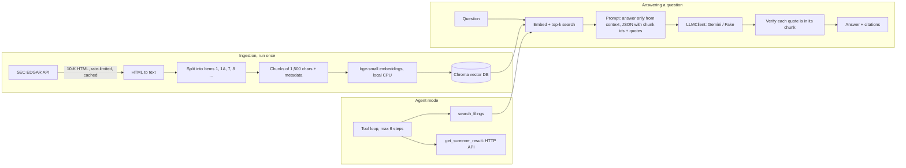

# SEC Filing Analyst

Ask plain-English questions about the latest 10-K annual reports of Apple, Microsoft,
NVIDIA, Tesla and Amazon. Every answer comes **only** from the filing text and cites the
exact passages it used. Each citation is checked by code: the quoted text must really
appear in the cited chunk. A tool-using agent can also combine the filings with live data
from a stock screener API.

Built with Python 3.12, sentence-transformers (local embeddings), Chroma (vector database),
Google Gemini (free tier) behind a provider-agnostic interface, FastAPI, pytest, Docker and
GitHub Actions.

## Results

Evaluation on 28 questions written from the downloaded filings (25 with a known answer and
source chunk, 3 that the filings cannot answer). Model `gemini-3.5-flash-lite`, top-k 5.
Full per-question table: [eval/results.md](eval/results.md).

| Metric | Value |
|---|---|
| Retrieval hit rate (source chunk in top 5) | 72.0% (18/25) |
| Answer correctness (expected fact in answer) | 80.0% (20/25) |
| Unanswerable questions correctly refused | 3/3 |
| Citation validity (quote found in cited chunk) | 100% (23/23) |

What the numbers say: when retrieval finds the right passage, the model answers correctly
and cites it verbatim. All 5 wrong answers came after a retrieval miss, and in each case the
model said "not found" instead of guessing. Retrieval is the bottleneck.

## Architecture



Source layout (`src/sec_analyst/`):

| Module | Role |
|---|---|
| `edgar.py` | find and download the latest 10-K (User-Agent, throttling, retries, cache) |
| `parsing.py` | HTML to text; detect 10-K Items; skip the table of contents |
| `chunking.py` | paragraph-packing chunker with overlap and stable chunk ids |
| `embeddings.py` | sentence-transformers embedder; hashing fake for tests |
| `store.py` | Chroma store and in-memory store behind one interface |
| `retrieval.py` | top-k semantic search with optional ticker filter |
| `citations.py` | build, verify and format citations |
| `rag.py` | grounded answering (one LLM call) |
| `llm.py` | `LLMClient` interface, `GeminiClient`, `FakeClient`, retry/backoff, `OpenAIClient` stub |
| `tools.py`, `agent.py` | the two agent tools and the tool-use loop |
| `pipeline.py`, `cli.py` | wiring and the command line |

A plain-language explanation of every part, with interview questions, is in
[docs/EXPLAINED.md](docs/EXPLAINED.md).

## Run it on Windows (PowerShell)

```powershell
python -m venv .venv
.venv\Scripts\python -m pip install -r requirements.txt
.venv\Scripts\python -m pip install --no-deps -e .
copy .env.example .env      # then set GEMINI_API_KEY and EDGAR_USER_AGENT in .env

.venv\Scripts\python -m pytest -q                              # offline unit tests
.venv\Scripts\python -m sec_analyst.cli check-config           # shows set / NOT SET, never values
.venv\Scripts\python -m sec_analyst.cli ingest                 # download + index (about 3 minutes)
.venv\Scripts\python -m sec_analyst.cli count                  # chunks per company
.venv\Scripts\python -m sec_analyst.cli ask "How much did Apple spend repurchasing its common stock in 2026?"
.venv\Scripts\python -m sec_analyst.cli ask "What are Tesla's main supply chain risks?" --ticker TSLA
.venv\Scripts\python -m sec_analyst.cli agent "What are NVIDIA's operating segments, and what does the screener say about NVDA?"
.venv\Scripts\python eval\run_eval.py                          # evaluation (cached LLM replies are reused)
```

`ask` makes one LLM call and `agent` usually two or three. Set `LLM_PROVIDER=fake` in `.env`
to try the pipeline without an API key (the fake model just quotes the top passage).

The first `ingest` downloads the embedding model (~130 MB) into `data/hf_cache` and the five
filings into `data/raw`. Both stay inside the project folder.

## Run it with Docker

```bash
docker compose build
docker compose run --rm analyst python -m sec_analyst.cli ingest
docker compose run --rm analyst python -m sec_analyst.cli ask "What are Apple's reportable segments?"
```

`data/` and `chroma_db/` are mounted as volumes, so the index survives container restarts.
The image installs CPU-only PyTorch and runs as a non-root user.
**The Dockerfile and docker-compose.yml were written and reviewed but not executed** during
the overnight build, because Docker commands were not permitted in that environment.

## Model choice

Default `LLM_MODEL=gemini-3.5-flash-lite`: a current Flash-class (Flash-Lite) Gemini model
that supports function calling and is on the free tier. The agent check and the full
evaluation were run with it. `gemini-3.8-flash`, the newest Flash model available to the key,
also works (verified with real calls), but its free tier allows only 20 requests per day
per model, fewer than one evaluation run needs. It also returned many 503 "high demand"
errors during the build. Gemini 3 models "think" before answering; `LLM_THINKING_LEVEL=low`
keeps latency down for this extraction-style task. Without it, one call ran into the server's
deadline (504).

Rate limits are handled with exponential backoff and jitter on 429/5xx (capped attempts,
logged), and a fast failure on daily-quota errors.

## Design choices

- **Grounding first.** The model must return JSON with chunk ids and verbatim quotes.
  Code verifies every quote, and unverifiable citations are flagged, not hidden.
- **Provider-agnostic LLM layer.** Everything uses `LLMClient.generate()` with neutral
  message and tool types. `OpenAIClient` is an explicitly unimplemented stub showing where
  a second provider plugs in. It is not tested and not claimed to work.
- **Offline tests.** 45 unit tests use a scripted fake LLM, a hashing fake embedder, an
  in-memory store, a temporary Chroma folder and a tiny local HTTP server that imitates the
  screener API. CI runs them with no secrets.
- **Simple over clever.** Pure semantic search and one prompt, with no frameworks. Each
  part can be read in a few minutes.

## Limitations

- Retrieval is pure vector search. It misses some exact-wording facts (employee counts, an
  address). See the eval table.
- Answer correctness is a string match on a short expected fact. It can mark a correct but
  differently phrased answer as wrong. 28 questions is a small evaluation.
- Citation verification proves the quote exists in the chunk. It does not prove the quote
  supports the claim (no faithfulness check yet).
- Tables lose their layout. Some filings (for example Microsoft) put table cells on
  separate lines.
- Only the latest 10-K per company is indexed. No 10-Qs, no history.
- The stock screener API was unreachable during the build, so the agent's screener path is
  verified only against the fake test server. Its URL path (`SCREENER_PATH`) is an assumption.
- Free-tier Gemini quotas (20 requests/day for some models) make heavy use impractical
  without a paid key.
- The answers may contain errors and are not investment advice.
