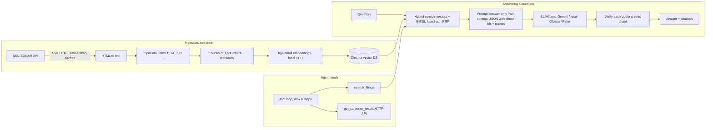

# SEC Filing Analyst

Ask plain-English questions about the latest 10-K annual reports of Apple, Microsoft,
NVIDIA, Tesla and Amazon. Every answer comes **only** from the filing text and cites the
exact passages it used. Each citation is checked by code: the quoted text must really
appear in the cited chunk. A tool-using agent can also combine the filings with live data
from a stock screener API.

Built with Python 3.12, sentence-transformers (local embeddings), Chroma (vector database),
Google Gemini (free tier, the default) or a privately hosted model through Ollama behind a
provider-agnostic interface, FastAPI, pytest, Docker and GitHub Actions. With Ollama, the
whole question-answering path runs on your own computer (see
[Running with a local model](#running-with-a-local-model-ollama)).

## Results

Evaluation on 28 questions written from the downloaded filings (25 with a known answer and
source chunk, 3 that the filings cannot answer). Model `gemini-3.5-flash-lite`, top-k 5.
Full per-question table: [eval/results.md](eval/results.md).

| Metric | v1: vector search | v2: hybrid search + citation repair |
|---|---|---|
| Retrieval hit rate (source chunk in top 5) | 72.0% (18/25) | **80.0%** (20/25) |
| Answer correctness (expected fact in answer) | 80.0% (20/25) | **88.0%** (22/25) |
| Unanswerable questions correctly refused | 3/3 | 3/3 |
| Citation validity (quote found in cited chunk) | 100% (23/23) | 100% (25/25) |

What the numbers say: v1 answered correctly and quoted verbatim whenever retrieval found the
right passage. All 5 wrong answers came after a retrieval miss, and each time the model said
"not found" instead of guessing. Adding BM25 keyword search fixed four of those misses.
One hybrid answer quoted a table row under a neighbouring chunk's id. The verifier caught
it, and citation repair re-attributed it to the chunk that really contains the quote. The
remaining errors are retrieval misses (nvda-1, amzn-5, tsla-3). How each change was measured
and kept: [docs/IMPROVEMENTS.md](docs/IMPROVEMENTS.md). Regression check:
`python scripts/compare_eval.py`.

### v3: a local model (Ollama) vs Gemini

The same 28 questions, retrieval, prompts and checks, run on 2026-11-25. The local model is
`llama3.2:3b` (3.2B parameters, 4-bit Q4_K_M), running on a laptop CPU (Intel Core Ultra 5
125U, 16 GB RAM, no discrete GPU; `ollama ps` shows 100% CPU). Gemini was re-run the same
day to measure its speed, and it reproduced the stored v2 scores exactly. Full table:
[eval/comparison_gemini_vs_ollama.md](eval/comparison_gemini_vs_ollama.md).

| Metric | Gemini `gemini-3.5-flash-lite` | Local `llama3.2:3b` (Ollama) |
|---|---|---|
| Retrieval hit rate | 80.0% (20/25) | 80.0% (20/25), same retriever |
| Answer correctness (answerable) | **88.0%** (22/25) | 76.0% (19/25) |
| Unanswerable questions correctly refused | 3/3 | 3/3 |
| Citation validity | **100%** (25/25) | 86.4% (19/22) |
| Seconds per question, mean (median) | **9.1 s (1.3 s)** | 33.8 s (34.1 s) |
| LLM errors | 0 | 0 |

The local model is worse, and the checks show where. It got 3 more questions wrong.
aapl-4 gave the share count instead of the dollar amount. msft-4 picked the owned-headquarters
figure instead of the total. nvda-5 answered just "72", which the strict string check marks
wrong without "GPUs". Three citations failed verification (msft-3, tsla-1, tsla-5) because
the model quoted only a number instead of a sentence. The verifier flagged each one as
unverified rather than letting it through. Like Gemini, it said "Not found" after every
retrieval miss and refused all 3 unanswerable questions. Gemini's mean time includes 13
server-side "503 overloaded" retries; its median is 1.3 s. The local model has no network
or quota limits but needs about 34 s per question on this CPU. Analysis:
[docs/IMPROVEMENTS.md](docs/IMPROVEMENTS.md#v3-privately-hosted-llm-via-ollama).

## Architecture



Source layout (`src/sec_analyst/`):

| Module | Role |
|---|---|
| `edgar.py` | find and download the latest 10-K (User-Agent, throttling, retries, cache) |
| `parsing.py` | HTML to text; detect 10-K Items; skip the table of contents |
| `chunking.py` | paragraph-packing chunker with overlap and stable chunk ids |
| `embeddings.py` | sentence-transformers embedder; hashing fake for tests |
| `store.py` | Chroma store and in-memory store behind one interface |
| `retrieval.py`, `keyword.py` | hybrid search: vectors + BM25 fused with reciprocal rank fusion; optional ticker filter |
| `citations.py` | build, verify, repair and format citations; neutralise prompt delimiters |
| `rag.py` | grounded answering (one LLM call) |
| `llm.py` | `LLMClient` interface, `GeminiClient`, `FakeClient`, retry/backoff, `OpenAIClient` stub |
| `ollama_client.py` | `OllamaClient`: local model via Ollama's `/api/chat`, localhost-only host check, validated tool calls |
| `tools.py`, `agent.py` | the two agent tools and the tool-use loop |
| `pipeline.py`, `cli.py` | wiring and the command line |
| `api.py`, `static/` | FastAPI backend and the single-page front end |

A plain-language explanation of every part, with interview questions, is in
[docs/EXPLAINED.md](docs/EXPLAINED.md). Design decisions and trade-offs are in
[docs/ARCHITECTURE.md](docs/ARCHITECTURE.md).

## Run it on Windows (PowerShell)

```powershell
python -m venv .venv
.venv\Scripts\python -m pip install -r requirements.txt
.venv\Scripts\python -m pip install --no-deps -e .
copy .env.example .env      # then set GEMINI_API_KEY and EDGAR_USER_AGENT in .env

.venv\Scripts\python -m pytest -q                              # offline unit tests
.venv\Scripts\python -m sec_analyst.cli check-config           # shows set / NOT SET, never values
.venv\Scripts\python -m sec_analyst.cli ingest                 # download + index (about 3 minutes)
.venv\Scripts\python -m sec_analyst.cli count                  # chunks per company
.venv\Scripts\python -m sec_analyst.cli ask "How much did Apple spend repurchasing its common stock in 2026?"
.venv\Scripts\python -m sec_analyst.cli ask "What are Tesla's main supply chain risks?" --ticker TSLA
.venv\Scripts\python -m sec_analyst.cli agent "What are NVIDIA's operating segments, and what does the screener say about NVDA?"
.venv\Scripts\python eval\run_eval.py                          # evaluation (cached LLM replies are reused)
```

`ask` makes one LLM call and `agent` usually two or three. Set `LLM_PROVIDER=fake` in `.env`
to try the pipeline without an API key (the fake model just quotes the top passage).

The first `ingest` downloads the embedding model (~130 MB) into `data/hf_cache` and the five
filings into `data/raw`. Both stay inside the project folder.

## Web app

```powershell
.venv\Scripts\python -m uvicorn sec_analyst.api:app --host 127.0.0.1 --port 8000
# or: .venv\Scripts\python -m sec_analyst.api
```

Open http://127.0.0.1:8000. The page has a question box, a company selector
(pills built from `/filings`), a mode switch (Agent with tools, or Direct with one model
call) and an Ask button (Enter submits). The answer card shows a "Citations verified"
badge and numbered source chips. Clicking a chip opens a quote card with the company,
fiscal year, section and chunk id, plus the full source passage with the quoted text
highlighted. Agent runs list their tool calls. There are loading, empty (three example
questions) and error states, and light and dark themes (follows the system setting, with a
toggle that is remembered). It is plain HTML, CSS and JavaScript: no build step, no CDN, no
external fonts. All server text is inserted with `textContent`.

| Endpoint | Description |
|---|---|
| `GET /health` | `{"status": "ok", "indexed_chunks": 1350, "llm_provider": ..., "model": ...}` |
| `GET /filings` | indexed companies: ticker, name, chunk count, fiscal year, filing date, source URL |
| `POST /ask` | body `{"question": str (3-500 chars), "ticker": "AAPL" (optional), "mode": "agent" or "rag"}` returns answer, found, grounded, citations (with source passage), agent steps, usage, latency |

Invalid input returns 422 with a readable message. If the LLM is rate-limited or down, the
response is 503 with a "try again" message. Unexpected errors return a generic 500 without
internals. `python scripts/smoke_server.py` starts the real server on 127.0.0.1, calls every
endpoint and stops it (`--fake` runs it without an API key).

## Running with a local model (Ollama)

The same pipeline can use a model that runs on your own computer through
[Ollama](https://ollama.com), so questions, retrieved filing text and answers never leave the
machine. Gemini stays the default; the local model is opt-in per command or per session.

```powershell
# 1. Once: install Ollama (Windows installer from ollama.com), open a NEW PowerShell window
#    so `ollama` is on PATH, and pull a model. The Ollama app keeps the server running.
ollama pull llama3.2:3b
ollama list
# If `ollama` is still not found:  & "$env:LOCALAPPDATA\Programs\Ollama\ollama.exe" list

# 2. One command at a time (your .env keeps LLM_PROVIDER=gemini)
.venv\Scripts\python -m sec_analyst.cli --provider ollama check-config
.venv\Scripts\python -m sec_analyst.cli --provider ollama list-models
.venv\Scripts\python -m sec_analyst.cli --provider ollama ask "How many full-time equivalent employees did Apple have?"
.venv\Scripts\python -m sec_analyst.cli --provider ollama agent "What are Tesla's main supply chain risks?" --ticker TSLA

# 3. Or for the whole PowerShell session (web app, evaluation)
$env:LLM_PROVIDER = "ollama"
$env:OLLAMA_MODEL = "llama3.2:3b"          # optional: this is the default
.venv\Scripts\python -m uvicorn sec_analyst.api:app --host 127.0.0.1 --port 8000
.venv\Scripts\python eval\run_eval.py        # writes eval\results_ollama.md; Gemini's eval\results.md is not touched
.venv\Scripts\python scripts\compare_eval.py --side-by-side gemini=eval\results.json ollama=eval\results_ollama.json
Remove-Item Env:LLM_PROVIDER, Env:OLLAMA_MODEL   # back to Gemini
```

| Setting | Default | Meaning |
|---|---|---|
| `LLM_PROVIDER` | `gemini` | `ollama` selects the local model (`--provider` overrides it per command) |
| `OLLAMA_MODEL` | `llama3.2:3b` | any model from `ollama list` (`--model` overrides it) |
| `OLLAMA_HOST` | `http://127.0.0.1:11434` | must be on this machine, see below |
| `OLLAMA_TIMEOUT_S` | `180` | read timeout for one call. There are no retries |
| `OLLAMA_NUM_CTX` | `8192` | context window in tokens. A warning is logged if a prompt nearly fills it |
| `OLLAMA_TOOL_MODE` | `auto` | `native` (Ollama tool calling), `json` (strict JSON tool calls for models without tool support), `auto` picks from the model's capabilities |
| `ALLOW_REMOTE_LLM` | empty | `1` allows a non-local `OLLAMA_HOST`. Leave it empty |

**Localhost only.** The point of this mode is that data stays on this computer, so
`OLLAMA_HOST` must be a loopback address (`127.0.0.1`, any `127.x.x.x`, `localhost` or `::1`).
Anything else, including a LAN address, `0.0.0.0`, a host name or a URL with a user name,
is refused before any request is sent, unless you set `ALLOW_REMOTE_LLM=1` on purpose (a
warning is then logged). The HTTP client also ignores `HTTP_PROXY`/`HTTPS_PROXY`, so a
proxy cannot reroute "local" traffic. Note that the Ollama server reads `OLLAMA_HOST` too:
if you set it to `0.0.0.0` to expose the server, this project will refuse it.

**What stays local and what does not.** With `LLM_PROVIDER=ollama`, the question, the
retrieved passages, the prompts and the answers stay on the machine (embeddings and the
vector database were already local). Still needing the internet: `ingest` (downloads public
filings from SEC EDGAR), the first download of the embedding model, and the agent's optional
`get_screener_result` tool, which sends only a ticker to `SCREENER_URL`.

**Same safety checks.** The local model gets the same prompts, the same JSON answer format,
code-verified citations with citation repair, the "Not found in the filings" refusal, the
prompt-injection hardening, and the agent's step limit. Tool calls from the local model are
validated, and a malformed one becomes a failed agent step rather than a crash.

If Ollama is not running you get `Ollama is not reachable at http://127.0.0.1:11434`. A
model that is not installed gives `Run ollama pull <model>`. A call that takes longer than
`OLLAMA_TIMEOUT_S` gives a timeout error. Each of these fails at once, without retrying.

## Run it with Docker

```bash
docker compose up --build web                      # web app on http://127.0.0.1:8000
docker compose run --rm cli python -m sec_analyst.cli ingest
docker compose run --rm cli python -m sec_analyst.cli ask "What are Apple's reportable segments?"
```

`data/` and `chroma_db/` are mounted as volumes, so the index survives container restarts.
Run `ingest` once (or reuse an index built on the host). The image installs CPU-only
PyTorch, runs as a non-root user and has a health check. Inside the container the server
listens on 0.0.0.0 (required for port publishing), and compose publishes it on the host's
127.0.0.1 only. On Linux hosts the mounted folders must be writable by the container user.
**The Dockerfile and docker-compose.yml were written and reviewed but not executed** during
the overnight build, because Docker commands were not permitted in that environment.

## Model choice

Default `LLM_MODEL=gemini-3.5-flash-lite`: a current Flash-class (Flash-Lite) Gemini model
that supports function calling and is on the free tier. The agent check and the full
evaluation were run with it. `gemini-3.8-flash`, the newest Flash model available to the key,
also works (verified with real calls), but its free tier allows only 20 requests per day
per model, fewer than one evaluation run needs. It also returned many 503 "high demand"
errors during the build. Gemini 3 models "think" before answering; `LLM_THINKING_LEVEL=low`
keeps latency down for this extraction-style task. Without it, one call ran into the server's
deadline (504).

Rate limits are handled with exponential backoff and jitter on 429/5xx (capped attempts,
logged), and a fast failure on daily-quota errors.

## Design choices

- **Grounding first.** The model must return JSON with chunk ids and verbatim quotes.
  Code verifies every quote, and unverifiable citations are flagged, not hidden. A real
  quote under the wrong chunk id is re-attributed (and marked as such).
- **Hybrid retrieval.** Vector similarity finds meaning, and BM25 finds exact terms
  (headcounts, addresses, table labels). Reciprocal rank fusion merges the two rankings.
  `RETRIEVAL_MODE=vector` turns it off.
- **Untrusted data.** Retrieved text and tool output are treated as data. Prompt
  delimiters inside passages are neutralised, and tests cover injection attempts.
- **Provider-agnostic LLM layer.** Everything uses `LLMClient.generate()` with neutral
  message and tool types. Two real providers are implemented: `GeminiClient` (default) and
  `OllamaClient` (local). `LLM_PROVIDER` switches between them, and both go through the
  same prompts, citation checks, refusal rule and agent step limit. `OpenAIClient` is
  still an explicitly unimplemented stub.
- **Offline tests.** 122 unit tests (including API tests with FastAPI's TestClient) use a scripted fake LLM, a hashing fake embedder, an
  in-memory store, a temporary Chroma folder, a tiny local HTTP server that imitates the
  screener API and a mocked HTTP session for Ollama. CI runs them with no secrets and no model.
- **Simple over clever.** Pure semantic search and one prompt, with no frameworks. Each
  part can be read in a few minutes.

## Limitations

- Retrieval still misses 5 of 25 source chunks (see the eval table). There is no reranker,
  and BM25 runs in memory (fine for ~1,400 chunks, not for millions).
- Answer correctness is a string match on a short expected fact. It can mark a correct but
  differently phrased answer as wrong. 28 questions is a small evaluation.
- Citation verification proves the quote exists in the chunk. It does not prove the quote
  supports the claim (no faithfulness check yet).
- Tables lose their layout. Some filings (for example Microsoft) put table cells on
  separate lines.
- Only the latest 10-K per company is indexed. No 10-Qs, no history.
- The stock screener API was unreachable during the build, so the agent's screener path is
  verified only against the fake test server. Its URL path (`SCREENER_PATH`) is an assumption.
- Free-tier Gemini quotas (20 requests/day for some models) make heavy use impractical
  without a paid key.
- The local model (`llama3.2:3b` on a laptop CPU) is less accurate (76% vs 88%), quotes less
  carefully (86.4% vs 100% verified citations) and is slower (about 34 s per question).
  In a real agent run it answered "Not found" to a two-part question (Tesla revenue + screener)
  that Gemini answered. Local mode is single-user, CPU-only and has no monitoring. A
  container cannot reach the host's Ollama on `localhost`, and `host.docker.internal` counts
  as remote, so Docker + Ollama needs `ALLOW_REMOTE_LLM=1`. That combination was not tested.
- The answers may contain errors and are not investment advice.
