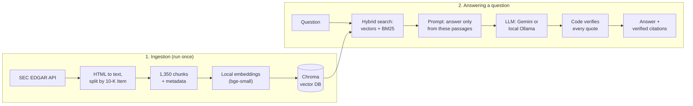

# SEC Filing Analyst

[](https://github.com/SeilkhanovN/sec-filing-analyst/actions/workflows/ci.yml)


**Ask plain-English questions about company annual reports and get answers you can check.**

SEC Filing Analyst answers questions about the latest 10-K annual reports of Apple,
Microsoft, NVIDIA, Tesla and Amazon. It answers **only from the filing text**, and every
answer cites the exact passage it came from. The citations are not taken on trust: code
checks that each quoted sentence really appears in the passage it cites. When the filings
do not contain the answer, it says so instead of guessing.

It runs on Google Gemini by default, or entirely on your own computer with a local model
through Ollama, so no data leaves the machine.

## Example

```text
> python -m sec_analyst.cli ask "How many full-time equivalent employees did Apple have?"

ANSWER:
As of September 26, 2026, Apple had approximately 167,000 full-time equivalent employees.

CITATIONS:
[1] Apple Inc. (AAPL) FY2026, Item 1. Business | AAPL-2026-item1-016:
    "As of September 26, 2026, the Company had approximately 167,000 full-time equivalent employees."
```

A question the filings cannot answer, such as *"What is the name of the head chef at Tesla's
office cafeteria?"*, gets: `Not found in the filings: the retrieved 10-K passages do not
contain this information.`

There is also a web app (FastAPI + a small accessible front end) that shows each answer with
clickable source chips and the full passage with the quote highlighted.

## Highlights

- **Retrieval-augmented generation (RAG)** over 1,350 passages from five 10-Ks. Hybrid
  search combines vector embeddings with BM25 keyword search and merges the two rankings
  with reciprocal rank fusion.
- **Answers you can verify.** The model must reply in JSON with passage ids and word-for-word
  quotes. Code checks every quote. A real quote filed under the wrong passage is re-attributed
  and marked, and anything that cannot be verified is flagged, never hidden.
- **Tool-using agent.** A short hand-written loop (no framework) that searches the filings
  and calls a stock-screener API. It has a hard step limit, and tool errors go back to the
  model as data instead of crashing the loop.
- **Swappable LLM providers.** Gemini (cloud) and Ollama (local) sit behind one small
  interface and go through exactly the same checks. Local mode only talks to `localhost`.
- **Measured, not guessed.** A 28-question test set written from the filings. A regression
  script compares every change with a stored baseline, and a change was kept only if no
  metric got worse.
- **Security basics.** Retrieved text and tool output are treated as untrusted
  (prompt-injection hardening, with tests), and secrets are never printed or logged.
- **Engineering.** FastAPI backend, 122 offline unit tests (no network, no API key) running
  in GitHub Actions, Docker files.

## Results

28 questions: 25 with a known answer and source passage, plus 3 that the filings cannot
answer. Scoring is strict: the expected fact must appear in the answer, and a citation counts
only if its quote is found in the cited passage.

| Metric | Gemini `gemini-3.5-flash-lite` (cloud) | `llama3.2:3b` via Ollama (local, laptop CPU) |
|---|---|---|
| Answer correctness | **88%** (22/25) | 76% (19/25) |
| Citations verified | **100%** (25/25) | 86% (19/22) |
| Unanswerable questions refused | 3/3 | 3/3 |
| Retrieval hit rate (source passage in top 5) | 80% (20/25) | 80% (same retriever) |
| Time per question, median (mean) | **1.3 s** (9.1 s) | 34 s (34 s) |

- **What improved it:** plain vector search found the source passage for 72% of questions
  and answered 80% correctly. Adding BM25 keyword search raised that to 80% and 88%, because
  the misses were exact-wording facts such as headcounts and addresses.
- **The local model** is private and has no quotas, but it is weaker and slower. It picks the
  wrong one of two numbers more often, and sometimes quotes a bare number instead of a
  sentence. The verifier flags those citations rather than letting them through. Both models
  refused all 3 unanswerable questions.
- **Gemini's mean time** includes server "overloaded" retries; the median is the typical case.

Per-question tables: [eval/results.md](eval/results.md) (Gemini) and
[eval/comparison_gemini_vs_ollama.md](eval/comparison_gemini_vs_ollama.md).
How each change was measured: [docs/IMPROVEMENTS.md](docs/IMPROVEMENTS.md).

## How it works



1. **Ingest:** download each company's latest 10-K from SEC EDGAR, convert the HTML to text,
   split it by 10-K section (Item 1, 1A, 7, 8, ...), and cut it into overlapping chunks with
   stable ids such as `AAPL-2026-item1-016`.
2. **Embed and index:** a small local embedding model turns each chunk into a vector, stored
   in Chroma.
3. **Retrieve:** for a question, take the best matches from vector search and from BM25
   keyword search, and fuse the two rankings.
4. **Answer:** the LLM sees only those passages and must reply with JSON: the answer plus,
   for every fact, a passage id and a quote copied word for word.
5. **Verify:** code checks each quote against the stored passage text and marks every
   citation as verified or not.

In **agent mode**, the model decides for itself when to search (possibly several times) and
when to call the stock-screener tool, for at most 6 steps.

| Module (`src/sec_analyst/`) | Role |
|---|---|
| `edgar.py` | find and download the latest 10-K (SEC User-Agent, throttling, retries, cache) |
| `parsing.py`, `chunking.py` | HTML to text, 10-K section detection, chunking with stable ids |
| `embeddings.py`, `store.py` | local embeddings, Chroma vector store |
| `retrieval.py`, `keyword.py` | hybrid search: vectors + BM25 with reciprocal rank fusion |
| `rag.py`, `citations.py` | grounded answering, quote verification and citation repair |
| `llm.py`, `ollama_client.py` | provider-agnostic LLM interface: Gemini, local Ollama, test fake |
| `agent.py`, `tools.py` | tool-use loop and its two tools |
| `api.py`, `static/` | FastAPI backend and the single-page front end |
| `cli.py`, `pipeline.py` | command line and wiring |

## Quick start (Windows PowerShell)

You need Python 3.12, a free [Gemini API key](https://aistudio.google.com/apikey) (or Ollama,
see below), and a name and email for SEC's required User-Agent.

```powershell
git clone https://github.com/SeilkhanovN/sec-filing-analyst.git
cd sec-filing-analyst
python -m venv .venv
.venv\Scripts\python -m pip install -r requirements.txt
.venv\Scripts\python -m pip install --no-deps -e .
copy .env.example .env      # then set GEMINI_API_KEY and EDGAR_USER_AGENT in .env

.venv\Scripts\python -m pytest -q                         # 122 offline tests, no keys needed
.venv\Scripts\python -m sec_analyst.cli check-config      # shows which settings are set, never their values
.venv\Scripts\python -m sec_analyst.cli ingest            # download and index the 5 filings (about 3 minutes)
.venv\Scripts\python -m sec_analyst.cli ask "How much did Apple spend repurchasing its common stock in 2026?"
.venv\Scripts\python -m sec_analyst.cli agent "What are NVIDIA's operating segments, and what does the screener say about NVDA?"
.venv\Scripts\python -m uvicorn sec_analyst.api:app --host 127.0.0.1 --port 8000   # web app at http://127.0.0.1:8000
```

On macOS or Linux, use `.venv/bin/python` and `cp`. CI runs the tests on Ubuntu. The first
`ingest` downloads the embedding model (about 130 MB) and the filings into `data/`, inside
the project folder.

## Running with a local model (Ollama)

Install [Ollama](https://ollama.com), pull a model, and add `--provider ollama`. The
question, the retrieved passages and the answer then never leave your computer.

```powershell
ollama pull llama3.2:3b
.venv\Scripts\python -m sec_analyst.cli --provider ollama ask "How many full-time equivalent employees did Apple have?"
.venv\Scripts\python -m sec_analyst.cli --provider ollama agent "What are Tesla's main supply chain risks?" --ticker TSLA

# or for the whole PowerShell session (web app, evaluation):
$env:LLM_PROVIDER = "ollama"
.venv\Scripts\python -m uvicorn sec_analyst.api:app --host 127.0.0.1 --port 8000
.venv\Scripts\python eval\run_eval.py        # writes eval\results_ollama.md; the Gemini results are not touched
Remove-Item Env:LLM_PROVIDER                  # back to Gemini
```

| Setting | Default | Meaning |
|---|---|---|
| `LLM_PROVIDER` | `gemini` | `ollama` for the local model (`--provider` overrides it per command) |
| `OLLAMA_MODEL` | `llama3.2:3b` | any model from `ollama list` |
| `OLLAMA_HOST` | `http://127.0.0.1:11434` | must be on this machine (see below) |
| `OLLAMA_TIMEOUT_S` | `180` | timeout for one call. There are no retries |
| `OLLAMA_TOOL_MODE` | `auto` | `native` (Ollama tool calling) or `json` (strict JSON tool calls for models without tool support) |

- **Localhost only.** `OLLAMA_HOST` must be a loopback address (`127.0.0.1`, `localhost` or
  `::1`). Any other host is refused before a request is sent, unless you set
  `ALLOW_REMOTE_LLM=1` on purpose. The client also ignores proxy settings.
- **Still online:** `ingest` downloads the public filings, the embedding model is downloaded
  once, and the agent's optional screener tool sends a ticker symbol to its API.
- **Clear failures:** if Ollama is not running, the model is not installed or a call times
  out, you get a one-line error at once.

## Web app and API

```powershell
.venv\Scripts\python -m uvicorn sec_analyst.api:app --host 127.0.0.1 --port 8000
```

Open http://127.0.0.1:8000. The page has a question box, company filters, and a switch
between agent mode and direct (one LLM call) mode. Answers show a "Citations verified"
badge and numbered source chips, and clicking a chip opens the full passage with the quote
highlighted. It is plain HTML, CSS and JavaScript, with no build step and no external scripts.

| Endpoint | Description |
|---|---|
| `GET /health` | status, number of indexed chunks, LLM provider and model |
| `GET /filings` | indexed companies with fiscal year, filing date and source URL |
| `POST /ask` | `{"question": "...", "ticker": "AAPL" (optional), "mode": "agent" or "rag"}` returns the answer, verified citations with their passages, agent steps and latency |

Invalid input returns 422, an unavailable LLM returns 503, and unexpected errors return a
generic 500 without internal details.

## Evaluation

```powershell
.venv\Scripts\python eval\run_eval.py                  # 28 questions; LLM replies are cached
.venv\Scripts\python scripts\compare_eval.py           # regression check against the v1 baseline
.venv\Scripts\python scripts\compare_eval.py --side-by-side gemini=eval\results.json ollama=eval\results_ollama.json
```

The questions were written from facts located in the downloaded filings, and a script
confirmed that each expected fact appears in its source passage. The runner reports
retrieval hit rate, answer correctness, refusals, citation validity and seconds per question.

## Design decisions

- **Verify, don't trust.** Asking for verbatim quotes and checking them in code proves that
  each quote exists. It does not prove that the quote supports the claim; that would need a
  faithfulness check.
- **Hybrid retrieval with rank fusion.** Vectors find meaning and BM25 finds exact terms.
  Fusing ranks, rather than adding scores, avoids tuning weights between two different scales.
- **Small and explicit.** No LangChain or LlamaIndex: the agent loop is about 100 lines,
  so every step is visible in the API response and easy to debug.
- **Offline tests.** A scripted fake LLM, a fake embedder, an in-memory store and mocked HTTP
  servers, so CI needs no secrets and costs nothing.

All 11 decision records, with alternatives and trade-offs: [docs/ARCHITECTURE.md](docs/ARCHITECTURE.md).

## Limitations

- The evaluation is small (28 single-fact questions), and correctness is a strict string
  match, so a correct answer phrased differently can be marked wrong.
- Retrieval still misses 5 of 25 source passages, and there is no reranker.
- Tables lose their layout. Some filings put table cells on separate lines.
- Only the latest 10-K per company is indexed: no quarterly reports and no history.
- The local 3B model on a CPU is clearly weaker and slower than Gemini (see Results).
- The Docker files (`docker compose up --build web`) are included but have not been tested
  end to end yet. The stock-screener tool is tested only against a fake server.
- The Gemini free tier has low daily request limits.
- Answers may contain errors and are not investment advice.

## Further reading

- [docs/EXPLAINED.md](docs/EXPLAINED.md): every part of the system in plain language, plus 25 interview questions and answers
- [docs/ARCHITECTURE.md](docs/ARCHITECTURE.md): architecture decision records
- [docs/IMPROVEMENTS.md](docs/IMPROVEMENTS.md): what was improved, how it was measured, and what was not done

Built with Python 3.12, sentence-transformers, Chroma, Google Gemini, Ollama, FastAPI,
pytest, Docker and GitHub Actions.
